# Homework 3 异构编程与性能分析

学号：10245102410  
姓名：吴博闻

系统信息：

- 操作系统：Ubuntu 26.04.1 LTS，Linux 7.0.0-31-generic。
- CPU：2 × Intel Xeon Gold 6133 @ 2.50 GHz，共 40 个物理核心、80 个逻辑处理器。
- 内存：247.26 GiB。

## Step 1. 创建环境

本次使用学校服务器完成 CPU 和 GPU 实验，复用已有 Python 环境；没有在魔搭创建 Notebook。

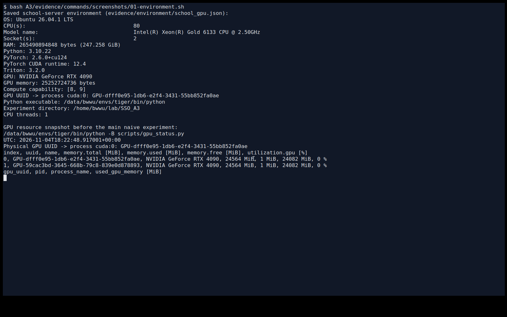

| 项目 | 实际配置 |
|---|---|
| GPU | NVIDIA GeForce RTX 4090，24 GB，Compute Capability 8.9；实验只使用一张卡 |
| Python | 3.10.22 |
| PyTorch / Profiler | 2.6.0+cu124 / `torch.profiler` |
| CUDA Runtime | 12.4；驱动 595.91.07 显示的 CUDA 支持版本为 13.2 |
| Triton | 3.2.0 |
| Perfetto | v59.1，Trace Processor 与浏览器界面 |

## Step 2. Softmax

2.2、2.4、2.5 均使用 `100×5000` 的 FP32 输入，随机种子为 `10245102410`，正式调用 200 次。CPU 计算线程设为 1；各版本使用相同输入值，GPU 实验使用同一张卡。输入生成、传输、首次编译及 5 次预热在采样前完成，三组主实验均设置 `with_stack=True`。

### 2.1 分析元素读写个数的数量

| 操作 | 读元素个数 | 写元素个数 |
|---|---:|---:|
| `x_max = x.max(dim=1)[0]` | $NM$ | $N$ |
| `z = x - x_max[:, None]` | $NM+N$ | $NM$ |
| `numerator = torch.exp(z)` | $NM$ | $NM$ |
| `denominator = numerator.sum(dim=1)` | $NM$ | $N$ |
| `ret = numerator / denominator[:, None]` | $NM+N$ | $NM$ |
| 总计 | $5NM+2N$ | $3NM+2N$ |

按题目对张量元素的统计方式，广播使用的每行最大值和分母各计一次读取，不展开为硬件访存事务。总读写为 $8NM+4N$ 个元素；代入本题尺寸，读 **2,500,200** 个、写 **1,500,200** 个，FP32 共 **16,001,600 bytes**。

### 2.2 针对 Softmax 进行性能分析

#### (1) 耗时最多的前三名算子

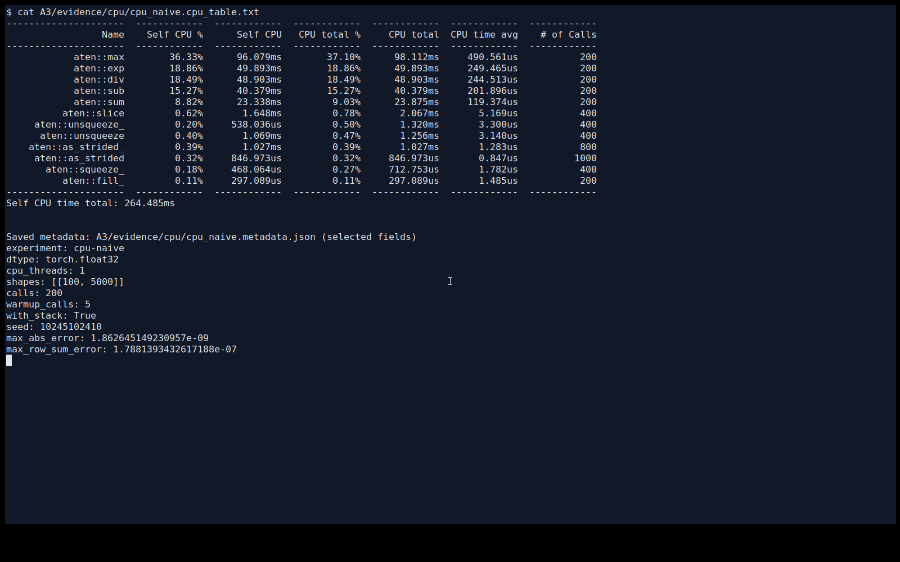

筛选全部 `aten::*` 行后，按 CPU total 排序：

| 算子 | 200 次累计 CPU total | CPU total 占比 |
|---|---:|---:|
| `aten::max` | 98.112155 ms | 37.096% |
| `aten::exp` | 49.893072 ms | 18.864% |
| `aten::div` | 48.902566 ms | 18.490% |

占比分母为 Profiler 的 Self CPU time total，即 264.485312 ms。

#### (2) 耗时原因

`max` 要比较全部 500,000 个输入元素并完成每行归约，耗时最高；实际 `x.max` 还计算索引，但 2.1 按老师给定方式只统计返回的最大值。`exp` 既要读写完整矩阵，又要计算指数；`div` 要读取分子、广播分母并写出整个结果，均有较大的逐元素处理量。五步实现把中间矩阵分别写回再读取，也增加了内存访问。

#### (3) Self CPU 与 CPU total

Self CPU 只统计算子自身的 CPU 时间，CPU total 还包含子调用。例如 `aten::max` 的 Self CPU 为 96.079 ms，CPU total 为 98.112 ms，差额来自内部调用。父调用的 total 已包含子调用，不能再把父子 total 相加作为总耗时；这一含义与 [PyTorch Profiler 说明](https://docs.pytorch.org/tutorials/recipes/recipes/profiler_recipe) 一致。

### 2.3 采用 Perfetto 进行性能分析

#### (1) 时间线与源码对应

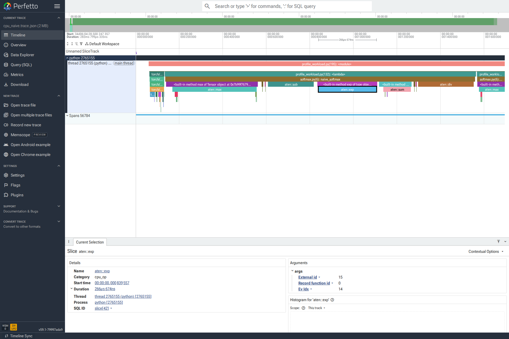

| 时间线事件 | [naive Softmax](src/softmax.py) 中的操作 |
|---|---|
| `aten::max` | `x.max(dim=1)[0]`，求每行最大值 |
| `aten::sub` | `x - x_max[:, None]`，平移输入 |
| `aten::exp` | `torch.exp(z)`，计算指数 |
| `aten::sum` | `numerator.sum(dim=1)`，求归一化因子 |
| `aten::div` | `numerator / denominator[:, None]`，归一化 |

五个主要操作按源码顺序出现，外层为 `naive_softmax`。广播索引附近还出现 `slice`、`unsqueeze`、`as_strided` 等视图操作；它们不是额外的完整矩阵计算。

#### (2) 指定 SQL 与平均时间

```sql
SELECT AVG(dur) / 1e9
FROM slice
WHERE name = 'aten::exp';
```


`dur` 的单位是 ns，结果 **0.00024946536 s = 249.46536 µs**，对应 2.2 中 `aten::exp` 的 **CPU time avg**，不是 200 次累计时间。

#### (3) exp 总 CPU 时间和比例

```sql
WITH cpu_roots AS (
    SELECT s.id, s.dur
    FROM slice s
    WHERE s.category = 'cpu_op' AND s.dur >= 0
      AND NOT EXISTS (
          SELECT 1 FROM ancestor_slice(s.id) a
          WHERE a.category = 'cpu_op'
      )
), exp_calls AS (
    SELECT COUNT(*) AS calls, SUM(dur) AS total_ns, AVG(dur) AS avg_ns
    FROM slice
    WHERE category = 'cpu_op' AND name = 'aten::exp' AND dur >= 0
), cpu_total AS (
    SELECT SUM(dur) AS total_ns FROM cpu_roots
)
SELECT e.calls, e.total_ns / 1e6 AS exp_total_ms,
       e.avg_ns / 1e3 AS exp_avg_us,
       t.total_ns / 1e6 AS all_self_cpu_ms,
       100.0 * e.total_ns / t.total_ns AS exp_cpu_total_pct
FROM exp_calls e CROSS JOIN cpu_total t;
```

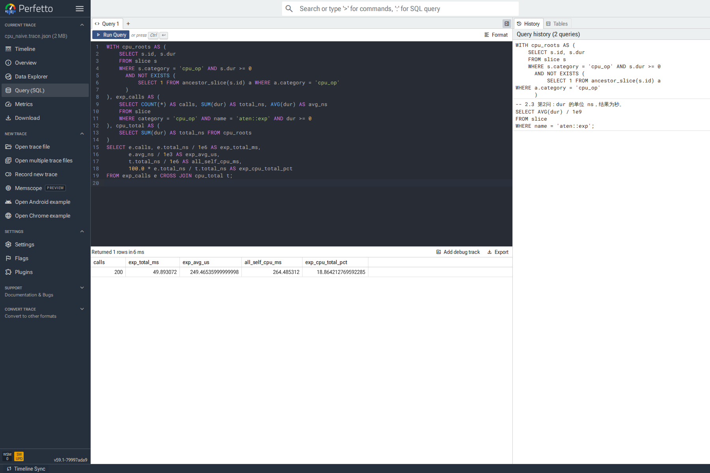

200 次 `exp` 共 **49.893072 ms**，占 **18.864213%**。分母取同一 CPU 线程中没有 `cpu_op` 祖先的算子区间之和，得到 264.485312 ms，与 Profiler 的 Self CPU 总和一致；这样避免了 Python 栈与 ATen 父子事件的重复累加。完整查询见 [perfetto_queries.sql](scripts/perfetto_queries.sql)。

### 2.4 在 GPU 上进行性能分析

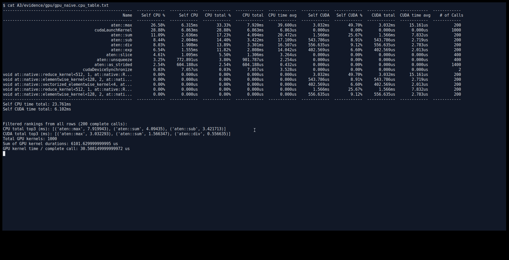

#### (1) CPU 时间前三名

| 算子 | 200 次累计 CPU total | CPU total 占比 |
|---|---:|---:|
| `aten::max` | 7.919943 ms | 33.332% |
| `aten::sum` | 4.094350 ms | 17.232% |
| `aten::sub` | 3.421713 ms | 14.401% |

CPU 占比分母为本组 Profiler 的 Self CPU 总和 23.760553 ms。

此时 CPU 主要进行 PyTorch 调度、张量准备和 kernel 提交，不能把这些时间当成 GPU 计算时间。时间线中 `max`、`sum` 归约的 CPU 调用及其内部 launch 较长；`sub` 也要建立广播计算并提交 kernel。`cudaLaunchKernel` 虽然累计 6.863 ms，但按题意不计入算子排名。

#### (2) GPU 时间前三名

| 算子 | 200 次累计 CUDA total | 占全部计算 kernel 时间 | 对应 kernel |
|---|---:|---:|---|
| `aten::max` | 3.032293 ms | 49.696% | `reduce_kernel`，`MaxOps` |
| `aten::sum` | 1.566347 ms | 25.671% | `reduce_kernel`，`sum_functor` |
| `aten::div` | 0.556635 ms | 9.123% | `elementwise_kernel`，`DivFunctor` |

两次归约合计约 75.37%，比逐元素操作更耗时；每行 5000 个元素需要在多个线程间归约，实际两个归约 kernel 的 grid 都只有 7 个 block，不能充分覆盖 128 个 SM。除法则读写完整矩阵。GPU 的指数计算通过并行 kernel 执行，本次没有进入 GPU 耗时前三名。

#### (3) CPU/GPU 时间线差异

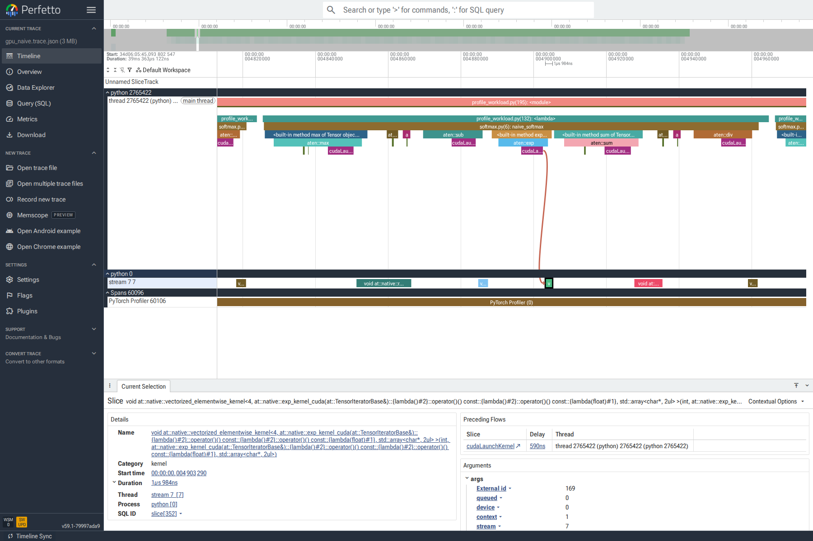

CPU 依次提交五个计算 kernel，GPU 在自己的 stream 上执行。箭头连接 `cudaLaunchKernel` 与对应 GPU kernel，两者的起止时刻不同，部分 kernel 在 launch 返回前已经开始；CPU 还可继续准备后续操作。CPU 调用返回只表示完成提交，不能认为 GPU 已算完，完整延迟需要在结束处同步。

### 2.5 在 Triton 实现的 Softmax 上进行性能分析

#### (1) 算子和调用关系比较

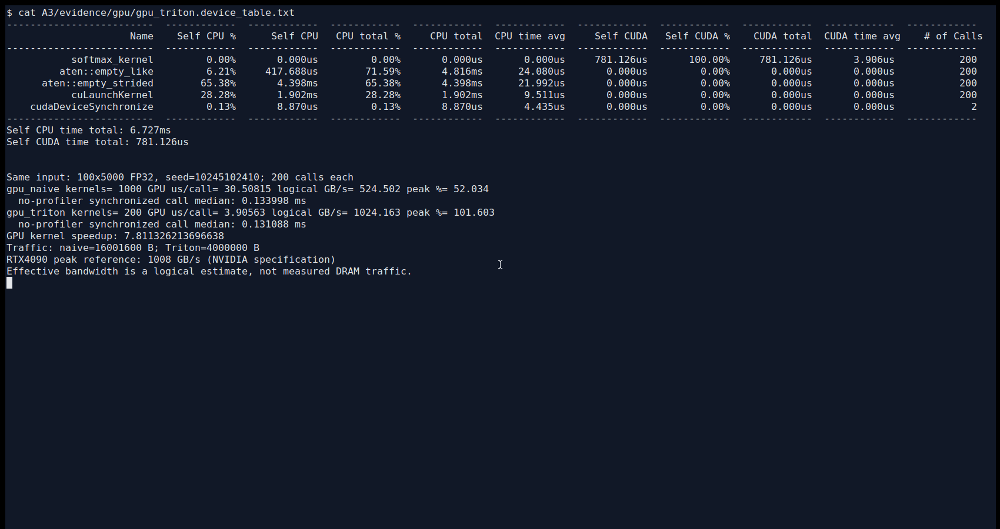

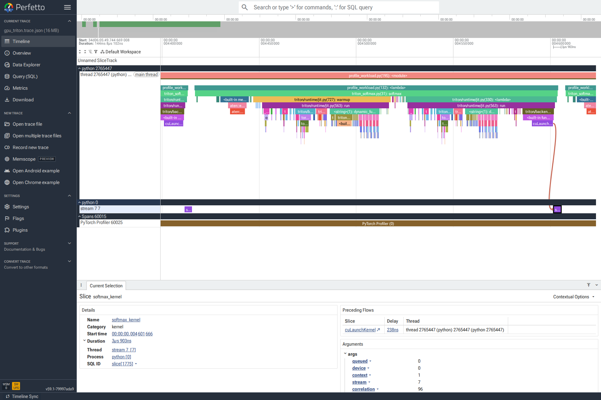

[Triton 源码](src/triton_softmax.py) 保留老师的 persistent programs、8 warps、资源占用计算及 grid 选择。5000 列扩展到 `BLOCK_SIZE=8192`，越界位置由 mask 屏蔽；每个 program 在片上完成最大值、减法、指数、求和及归一化，再写出结果。

naive 每次启动 5 个计算 kernel，200 次共 1000 个；Triton 每次只启动 1 个，200 次共 200 个。融合减少了 launch 次数和中间矩阵的反复读写。与 `torch.softmax` 比较，正式输入的最大绝对误差为 **1.397×10⁻⁹**，最大行和误差为 **1.788×10⁻⁷**。

按 200 次完整调用的全部计算 kernel 时间统计，naive 为 **30.50815 µs/次**，Triton 为 **3.90563 µs/次**，kernel 时间比为 **7.811 倍**。另在关闭 Profiler 后分别同步计时 5 次，完整调用中位数为 133.998 µs 和 131.088 µs；教师 wrapper 每次仍有 `warmup` API、资源查询和 Python 调用开销，因此这里没有得到相同倍数的整体延迟下降。

#### (2) 有效带宽与性能限制

naive 按 2.1 计算逻辑访问量；Triton 估计读取输入一次、写出输出一次：

$$
B_{naive}=4(8NM+4N)=16,001,600\ \text{bytes}
$$

$$
B_{Triton}=4(2NM)=4,000,000\ \text{bytes},\qquad
BW_{eff}=\frac{B}{1000\,t_{\mu s}}\ \text{GB/s}
$$

| 实现 | 200 次 kernel 时间合计 | 单次完整 Softmax kernel 时间 | 逻辑访问量 | 有效带宽 | 占 1008 GB/s 的比例 |
|---|---:|---:|---:|---:|---:|
| naive | 6101.630 µs | 30.50815 µs | 16,001,600 B | 524.502 GB/s | 52.034% |
| Triton | 781.126 µs | 3.90563 µs | 4,000,000 B | 1024.163 GB/s | 101.603% |

naive 的分母是五个 kernel 的时间之和，不是其中某个 kernel 的平均时间。RTX 4090 的参考显存带宽 **1008 GB/s** 来自 [NVIDIA Ada 架构白皮书附录 A，第 30 页](https://images.nvidia.com/aem-dam/Solutions/geforce/ada/nvidia-ada-gpu-architecture.pdf#page=30)。

naive 的计算密度较低，访存、归约和多次启动的开销明显；Triton 融合后减少了访存与启动，但仍要做行内归约和指数计算，100 行也限制了并行规模。Triton 的逻辑有效带宽略超 DRAM 峰值，说明不能把它直接视为实测显存流量：重复使用的小输入可能命中缓存。仅凭这组带宽比例，无法严格判定各自属于访存受限还是计算受限；本次证据支持融合减少访问和调度开销，不能证明已达到 DRAM 带宽或浮点计算峰值。

### 2.6 实现 Online Softmax

#### (1) PyTorch 实现

按题图 Algorithm 3 实现，沿列递推、同时处理全部行：

```python
def online_softmax(x):
    n_rows, n_cols = x.shape
    m = torch.full((n_rows,), -float("inf"), dtype=x.dtype, device=x.device)
    d = torch.zeros((n_rows,), dtype=x.dtype, device=x.device)
    for j in range(n_cols):
        x_j = x[:, j]
        new_m = torch.maximum(m, x_j)
        d = d * torch.exp(m - new_m) + torch.exp(x_j - new_m)
        m = new_m
    return torch.exp(x - m[:, None]) / d[:, None]
```

更新 `d` 时保留旧 `m`，随后才更新最大值。随机输入、同行元素相等、大幅度正负有限值、单行/单列及完整尺寸都与 `torch.softmax` 比较，使用 `rtol=1e-4, atol=1e-6`；正式输入最大绝对误差为 **2.235×10⁻⁸**，最大行和误差为 **2.563×10⁻⁶**。算法参考题图及 [Online normalizer calculation for softmax](https://arxiv.org/abs/1805.02867)。

#### (2) 与 naive 的性能比较

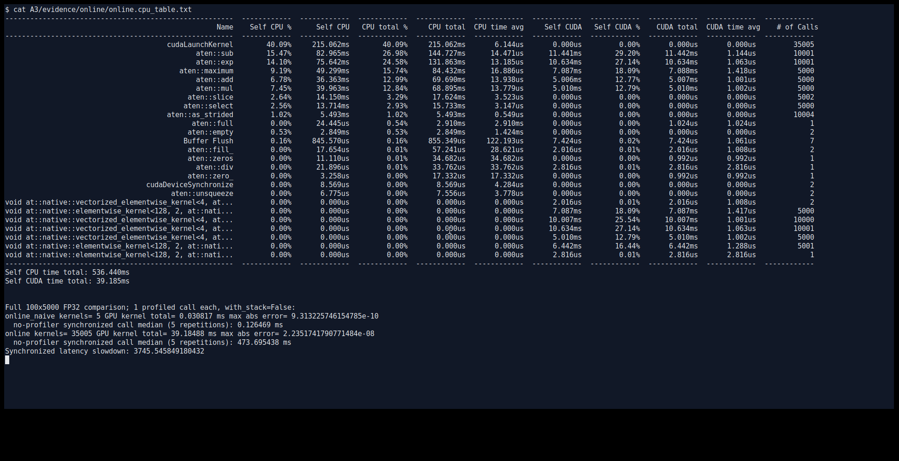

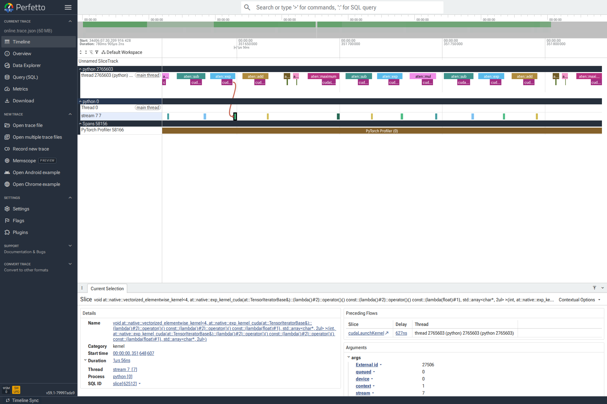

两者均采用完整 `100×5000` FP32 输入，Profiler 各采样 1 次，均关闭栈采集；另各做 5 次无 Profiler 的同步完整调用计时。

| 实现 | 一次调用的 ATen 事件数 | GPU kernel 数 | Profiler 中计算 kernel 时间合计 | 无 Profiler 同步调用中位数 |
|---|---:|---:|---:|---:|
| naive | 16 | 5 | 0.030817 ms | 0.126469 ms |
| Online | 55,018 | 35,005 | 39.184880 ms | 473.695438 ms |

本次 PyTorch Online 实现约慢 **3745.5 倍**，这里比较的是无 Profiler 的完整调用中位数。每列产生 maximum、两次 sub、两次 exp、mul、add 共 7 个小 kernel，再加初始化和最终输出，共 $5000×7+2+3=35005$ 个。时间线中这些小 kernel 之间有明显提交间隔，远多于 naive 的五步计算。

在线算法把最大值和归一化因子合并更新，理想融合实现可减少输入遍历；但当前 eager 写法把状态和临时结果反复写入张量，每个递推 kernel 只处理 100 个元素。`x[:, j]` 还按行跨越 5000 个元素读取，列间又存在递推依赖，难以充分利用 GPU。它比 naive 计算更多指数，状态和临时张量的读写也要计入流量，不能只凭算法的输入遍历次数判断 FLOP/Byte；本次完整调用的开销反而明显增加。

## Step 3. 实现 Attention

[源码](src/attention.py) 直接实现单头、前向 Attention：

```python
scores = q @ k.T
scores = scores / math.sqrt(q.shape[-1])
probabilities = torch.softmax(scores, dim=-1)
output = probabilities @ v
```

性能实验使用 FP32、$d_k=d_v=64$，`L=512` 为主要规模，各规模采样 10 次；矩阵乘设置为 `highest`，关闭 TF32。正确性对照同一 FP32 输入上的 CPU FP64 稳定公式，覆盖非方形输入、$d_k\ne d_v$、`Q=0` 和长度为 1 等情况；9 个 GPU 用例的最大绝对误差为 **2.844×10⁻⁷**，均满足 `rtol=1e-4, atol=1e-6`。

### (1) 性能瓶颈

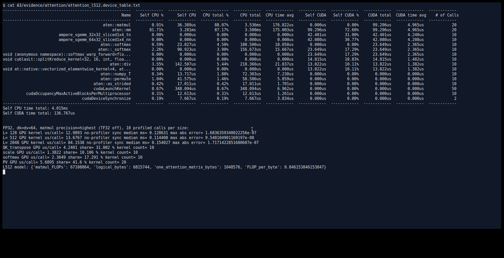

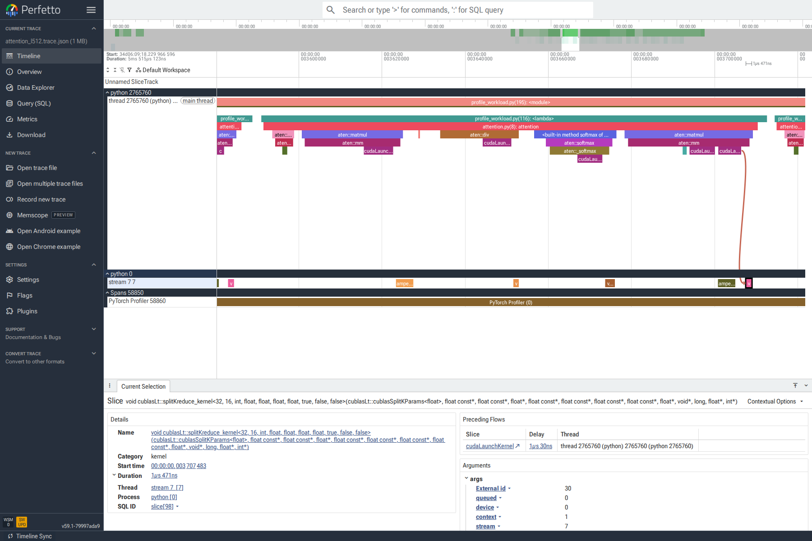

L=512 时两次矩阵乘合计占 **72.602%** 的 GPU kernel 时间，是主要计算开销。按 CPU 事件的关联编号分开统计四个阶段，结果如下；同一次矩阵乘产生的 GEMM 和 split-K 归约都计入该阶段。

| 阶段 | 10 次累计 GPU 时间 | 单次平均 | GPU kernel 时间占比 |
|---|---:|---:|---:|
| $QK^T$ | 42.401 µs | 4.2401 µs | 31.002% |
| 缩放 | 13.822 µs | 1.3822 µs | 10.106% |
| Softmax | 23.649 µs | 2.3649 µs | 17.291% |
| $PV$ | 56.895 µs | 5.6895 µs | 41.600% |
| 合计 | 136.767 µs | 13.6767 µs | 100% |

第二次矩阵乘耗时最高，包含 GEMM 与 split-K 结果归约两个 kernel；因此四阶段在这里实际对应 5 个 kernel。Profiler 中 `aten::matmul` 包含 `aten::mm`，`aten::softmax` 包含 `aten::_softmax`，不能重复相加。CPU 还承担框架与 launch 开销，完整调用的无 Profiler 中位数为 114.408 µs，明显大于 kernel 时间合计。

### (2) 内存访问模式

设 $Q:L_q×d_k$、$K:L_k×d_k$、$V:L_k×d_v$，并记 $A=L_qL_k$。

| 阶段 | 主要读取 | 写出 | 访问特征 |
|---|---|---|---|
| $QK^T$ | $L_qd_k+L_kd_k$ 个元素 | $A$ 个分数 | GEMM 分块复用 Q/K；`K.T` 为转置视图 |
| 缩放 | $A$ 个分数 | $A$ 个缩放值 | 逐元素连续读写，产生新矩阵 |
| Softmax | $A$ 个缩放值 | $A$ 个概率 | 按行求最大值、指数和归一化 |
| $PV$ | $A+L_kd_v$ 个元素 | $L_qd_v$ 个输出 | GEMM 分块复用概率矩阵与 V |

分数和概率矩阵都被物化，缩放、Softmax 和后一次矩阵乘会再次读写它们。矩阵乘有缓存与分块复用，Softmax 的归约以及 split-K 也可能产生额外访问，表中的张量量不等于实际 DRAM 流量。

### (3) 时间复杂度、空间复杂度与计算密度

两次矩阵乘的时间主项为 $O(L_qL_k(d_k+d_v))$，缩放与 Softmax 另需 $O(L_qL_k)$。包括输入、输出和显式注意力矩阵的总空间为

$$
O(L_qd_k+L_kd_k+L_kd_v+L_qd_v+L_qL_k).
$$

只看额外工作空间，则主要是分数/概率矩阵的 $O(L_qL_k)$，另有 GEMM 工作区。当 $L_q=L_k=L$、$d_k=d_v=d$ 时，时间为 **$O(L^2d)$**，总空间为 **$O(Ld+L^2)$**。

以一次乘加计 2 FLOPs，两次矩阵乘共

$$
F_{mm}\approx2L_qL_k(d_k+d_v).
$$

在“各阶段输入读一次、输出写一次”的 FP32 简化模型中，四阶段一共访问

$$
B_{logical}\approx4(L_qd_k+L_kd_k+L_kd_v+L_qd_v+6L_qL_k)\ \text{bytes}.
$$

其中 $6L_qL_k$ 分别来自第一阶段写分数、缩放读写、Softmax 读写以及第二次矩阵乘读概率。代入 $L=512,d=64$，矩阵乘主项为 **67,108,864 FLOPs**，逻辑访问量为 **6,815,744 bytes**，计算密度约 **9.846 FLOP/Byte**。这里省略了缩放和 Softmax 的 $O(L^2)$ 运算，也没有测量硬件流量，不能把该值视为 GPU 实测算术强度。

### (4) 长序列面临的挑战

| L | 单个 FP32 注意力矩阵 | 每次 kernel 数 | GPU kernel 时间合计/次 | 无 Profiler 同步完整调用中位数 |
|---:|---:|---:|---:|---:|
| 128 | 0.0625 MiB | 6 | 12.9893 µs | 128.631 µs |
| 512 | 1 MiB | 5 | 13.6767 µs | 114.408 µs |
| 2048 | 16 MiB | 5 | 84.1538 µs | 154.027 µs |

每档 kernel 数据为 10 次调用的平均值，完整调用时间为另做 5 次同步计时的中位数。L=2048 时 Softmax 单阶段平均 25.8752 µs，占 30.748%，已略高于任意一次矩阵乘；两次矩阵乘合计仍占 58.088%。

序列长度增长会让分数/概率矩阵及矩阵乘运算量按平方增长，也会增加内存访问和中间结果占用。L 从 128 增至 2048，单个注意力矩阵由 64 KiB 增至 16 MiB；分数和概率同时存在时还需保存两份矩阵。短序列的完整延迟主要受框架调度和测量波动影响，并不随尺寸严格单调；较长序列则明显增加 GPU 计算与 Softmax 的时间，计算和存储的平方增长都会限制可处理的长度。
