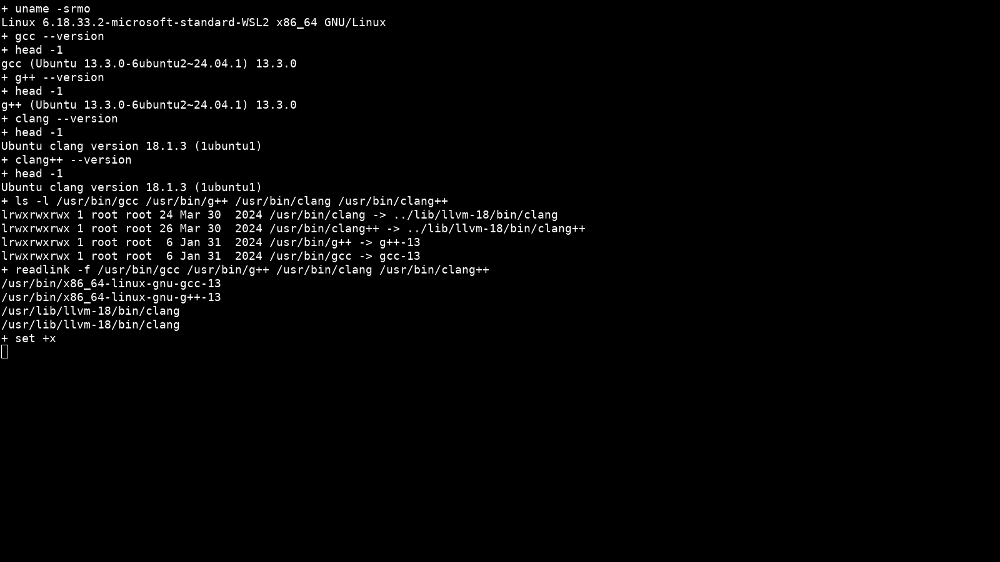
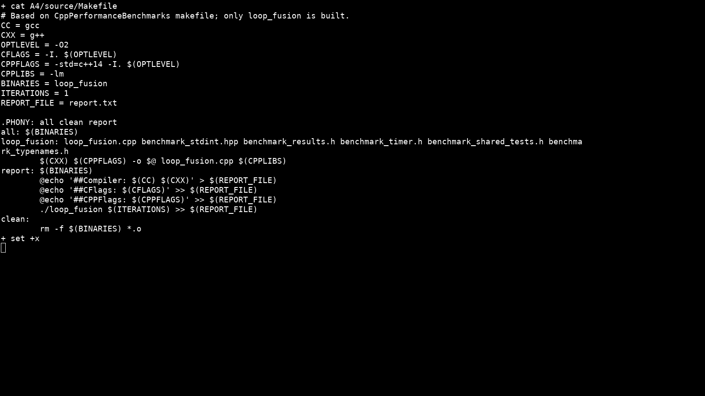
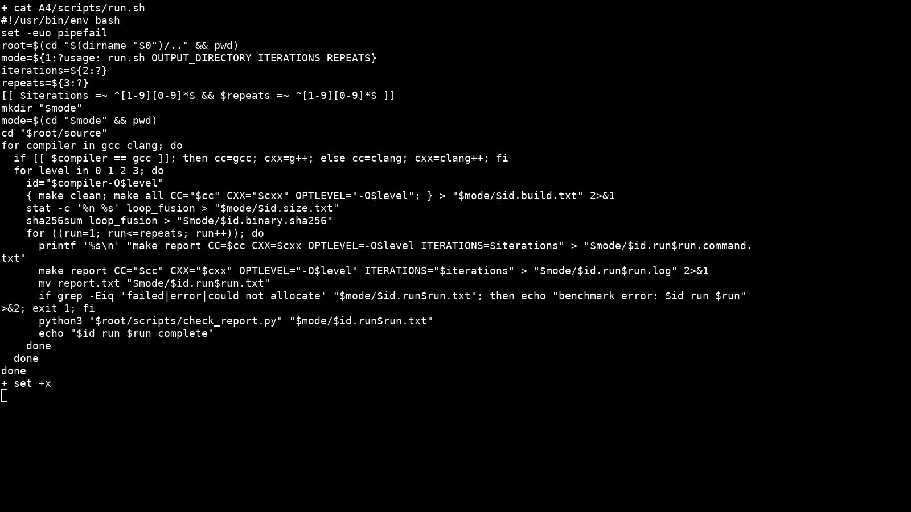
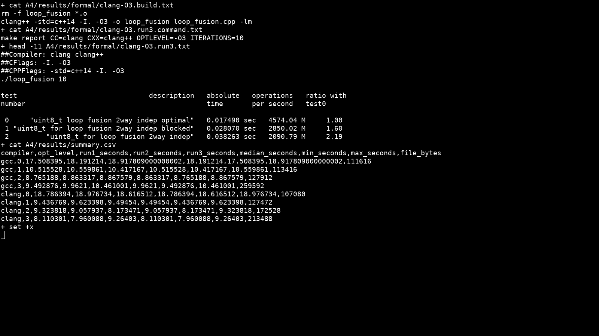
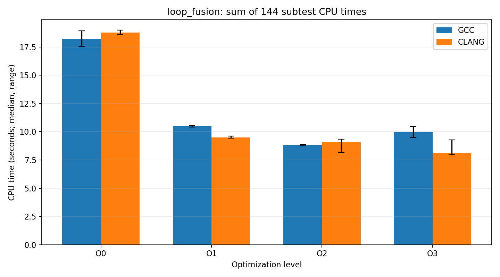
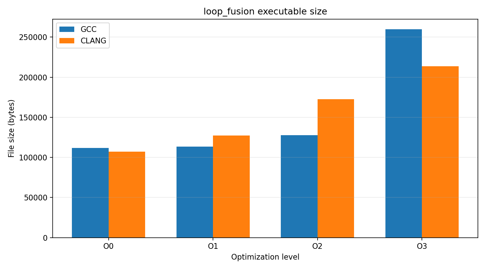

# 上机作业 A4：GCC 与 Clang/LLVM 的优化比较

学号：10245102410  
姓名：吴博闻

实验环境：Ubuntu 24.04.2 LTS（WSL2，x86-64），Intel Core Ultra 9 185H，内存 15 GiB。

## Write-up 1

GCC/G++ 均为 13.3.0，Clang/Clang++ 均为 18.1.3。四个命令均在 `/usr/bin`：

| 命令 | 符号链接及最终可执行文件 |
|---|---|
| gcc | `/usr/bin/gcc` → `gcc-13` → `x86_64-linux-gnu-gcc-13` |
| g++ | `/usr/bin/g++` → `g++-13` → `x86_64-linux-gnu-g++-13` |
| clang | `/usr/bin/clang` → `/usr/lib/llvm-18/bin/clang` |
| clang++ | `/usr/bin/clang++` → `/usr/lib/llvm-18/bin/clang++` → `clang` |

GCC 的 C 和 C++ 命令最终指向两个不同文件；Clang 的两个命令最终指向同一可执行文件，并根据调用名称选择驱动行为。符号链接提供不带版本号的稳定命令名，也方便多个版本共存和切换默认版本。



## Write-up 2

选择 `loop_fusion`。它比较独立循环、覆盖、替换和偏移等不同循环写法，使用 `uint8_t`、`int32_t` 和 `double` 数组，适合观察编译器优化和访存模式的影响。源码来自 [CppPerformanceBenchmarks](https://gitlab.com/chriscox/CppPerformanceBenchmarks)，提交 `f146846aebbd087ec58b23a3cdb3c5fbd26b5e34`。

## Write-up 3

[Makefile](source/Makefile) 仅构建和运行 `loop_fusion`，并将优化等级统一交给 `OPTLEVEL`，避免原 Makefile 固定的 `-O3` 覆盖比较设置。`BINARIES` 指定构建目标；`CC` 和 `CXX` 分别指定 C、C++ 编译器，本测试使用后者；`report` 运行程序并写入 `report.txt`。

`loop_fusion.cpp` 没有修改。运行参数固定为 `iterations=10`、初值 3；最后的 offset 子测试按原程序将迭代数乘以 10。原计时输出只有两位小数，在 [benchmark_results.h](source/benchmark_results.h) 中将秒数显示改为六位，计时方式与测试逻辑不变。计时使用 `clock()` 测量进程 CPU 时间。



## Write-up 4

[Shell 脚本](scripts/run.sh) 依次选择两套编译器和四个优化等级，每组先 `make clean`、重新编译，记录可执行文件大小和哈希，再运行三次，分别保存报告。脚本检查退出状态、程序的失败信息及计时行数，避免失败或缺失结果被当作有效数据。

在 `A4` 目录可用以下命令重跑到一个新的目录，输出目录必须不存在：

```sh
scripts/run.sh results/repeat 10 3
python3 scripts/analyze.py
```

分析脚本默认读取已保存的 `results/formal`；如需分析重跑数据，应另行调整输入目录。下图中的命令和结果来自已保存的正式运行。





## Write-up 5

每次运行将 144 个子测试的 CPU 时间相加，再取三次运行的中位数；误差线表示最小值到最大值。所有组合使用相同输入和迭代设置。该总和是各计时区间之和，不是包含初始化和输出的整进程墙钟时间。[完整原始结果](results/formal/)和[逐项数据](results/subtests.csv)均已保存。

| 编译器 | 优化 | 时间中位数（秒） | 可执行文件（字节） |
|---|---:|---:|---:|
| GCC | O0 | 18.191 | 111616 |
| GCC | O1 | 10.516 | 113416 |
| GCC | O2 | 8.863 | 127912 |
| GCC | O3 | 9.962 | 259592 |
| Clang | O0 | 18.786 | 107080 |
| Clang | O1 | 9.495 | 127472 |
| Clang | O2 | 9.058 | 172528 |
| Clang | O3 | 8.110 | 213488 |





从 O0 到 O1，GCC 的时间中位数下降约 42%，Clang 下降约 49%。GCC O3 的中位数为 9.962 秒，高于 O2 的 8.863 秒；Clang 的 O2 和 O3 范围有重叠，三次数据不足以确认较小差异稳定。以 Clang O3 的 `int32_t` 四路独立循环为例，手工合并的循环中位数为 0.031759 秒，分离循环为 0.103369 秒。两者访问同一数组的方式不同，但这些数据不能单独证明编译器执行了哪一种优化。

文件大小与运行时间并不简单对应：GCC O3 为 259592 字节，比 O2 的 127912 字节大，在这组测量中反而更慢。文件大小还包含可执行文件格式和其他段，不能直接当作实际执行指令量。WSL 调度及主机负载会影响比较，短子测试的数值尤其需要谨慎解释。

## Perf 选做

系统 `perf` 包装器找不到匹配 WSL 内核的工具；现有的 perf 6.8.12 可以运行，但 `cycles`、`instructions`、`cache-misses` 和 `branch-misses` 均为 `<not supported>`。软件事件 `task-clock` 可计数，但不能替代硬件事件，所以无法计算 IPC 或据此分析缓存、分支和指令效率。
