# 实践项目 P2：Profiling Serial Merge Sort

学号：10245102410  
姓名：吴博闻

- 操作系统：Ubuntu 24.04.2 LTS，WSL2，Linux 6.18.33.2-microsoft-standard-WSL2。
- CPU：Intel Core Ultra 9 185H，WSL2 显示 22 个逻辑 CPU。
- 内存：WSL2 显示总内存约 15.42 GiB。

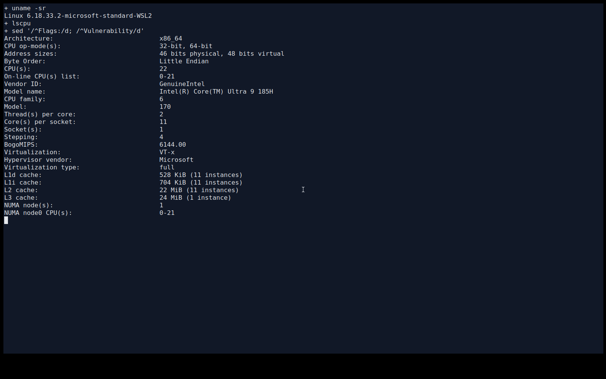

[lscpu 完整输出](lscpu.txt)。缓存和拓扑信息按 WSL2 显示的结果记录。

## Checkoff Item 1

瓶颈是插入排序中反复比较、向后移动元素的内层循环。`make isort DEBUG=1` 使用 `-Wall -O0 -g`；对原题的 `./isort 10000 10` 采样，`isort` 的 Self 占比为 100%，共 227 个样本，没有丢失样本。

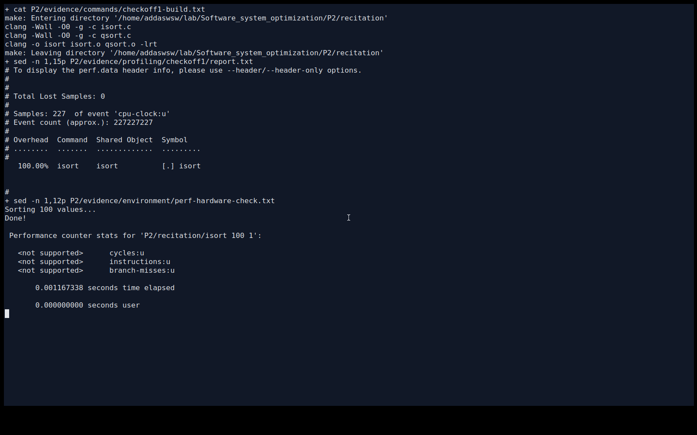

这里使用已安装的 Perf 6.8.12 可执行文件 `/usr/lib/linux-tools-6.8.0-147/perf`。系统 Perf 包装器不能按 WSL 内核名称找到程序；直接运行该文件可采样并关联源码。硬件 `cycles:u`、`instructions:u`、`branch-misses:u` 均显示不支持，因此采样事件为 `cpu-clock:u`，以下百分比表示用户态 CPU 时间样本的分布，不是硬件事件计数。

最热的源码位置是 [recitation/isort.c](recitation/isort.c) 第 **20 行**：

```c
while (index >= left && *index > val) {
```

`perf annotate` 将约 **63.00%** 的样本归到该行，对应的主要指令包括：

```asm
11d1: 48 3b 4d f8    cmp  -0x8(%rbp),%rcx    # index 与 left
11e2: 8b 00          mov  (%rax),%eax         # 读取 *index
11e4: 3b 45 e4       cmp  -0x1c(%rbp),%eax    # 与 val 比较
11e7: 0f 97 c0       seta %al
11ea: 88 45 d7       mov  %al,-0x29(%rbp)     # 单指令样本最多：14.54%
11f0: a8 01          test $0x1,%al
```

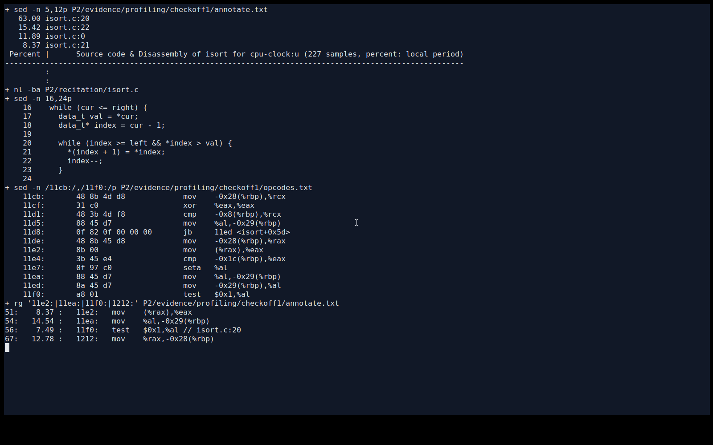

随机输入中，插入一个元素可能要反复扫描、搬移前面的元素，总工作量为 O(n²)。在 O0 下，循环条件还包含多次栈变量读写和条件结果的保存。样本说明时间集中在这个循环附近；采样位置可能偏离导致停顿的指令，不能把 63% 当成这条 C 语句精确的独占耗时，也不能据此断言是 cache miss 或 branch miss 导致。

## Checkoff Item 2

原始设置的工作集为 `U × sizeof(uint32_t) = 40,000,000` 字节，大于模拟的末级缓存，随机读取频繁未命中，结果符合预期。`N` 决定随机访问次数，`U` 决定数组长度和随机下标范围。

使用 Valgrind 3.22.0，显式开启 `--cache-sim=yes --branch-sim=yes`。Cachegrind 模拟配置为 I1 **64 KiB / 16 路**、D1 **48 KiB / 12 路**、LL **24 MiB / 12 路**，缓存行均为 **64 B**。这里的统计来自模拟。

| U | N | 数组字节数 | D1 misses | D1 miss rate | LLd misses | LLd miss rate |
|---:|---:|---:|---:|---:|---:|---:|
| 10,000,000 | 100,000,000 | 40,000,000 | 100,505,350 | 16.47493% | 37,858,319 | 6.20577% |
| 4,096 | 100,000,000 | 16,384 | 1,845 | 0.00031% | 1,664 | 0.00028% |
| 1,048,576 | 100,000,000 | 4,194,304 | 98,898,555 | 16.45296% | 66,947 | 0.01114% |
| 10,000,000 | 10,000,000 | 40,000,000 | 10,614,508 | 15.15273% | 4,350,157 | 6.21006% |
| 10,000,000 | 50,000,000 | 40,000,000 | 50,566,128 | 16.30902% | 19,238,614 | 6.20500% |

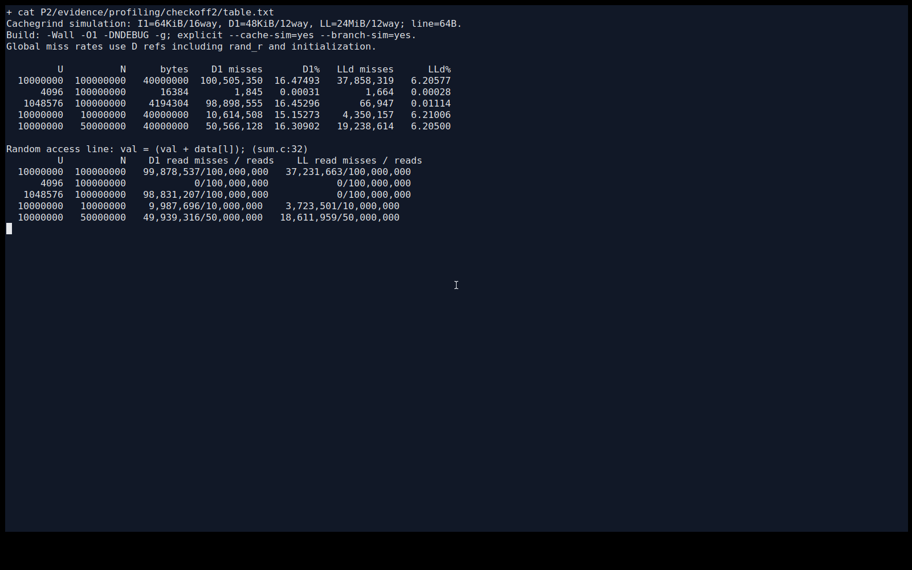

表中百分比以整个进程的 D refs 为分母，包含 `rand_r` 和初始化。只看 [sum.c](recitation/sum.c) 第 **32 行** `val = (val + data[l]);`，原始设置的 1 亿次读取中，D1 未命中 **99,878,537** 次，LL 未命中 **37,231,663** 次，约为 **99.88%** 和 **37.23%**。

固定 N 时，16 KiB 数组能放入 D1，初始化后随机读取没有产生该行的 D1/LL 未命中；4 MiB 数组能放入 LL，但放不进 D1，因此 D1 仍频繁未命中，该行 LL 未命中为 0。固定 U=1 千万、减小 N 时，总 miss 随访问次数减少，但随机读取行的未命中比例仍约为 99.88% / 37.23%，并没有提高命中效率。

减少工作集，或在允许改变访问顺序时按块处理、提高局部性，可以降低 miss。只减少 N 是少做工作。最初按默认 `make sum` 的 O1 构建完成了原设置；为显示源码行，表中所有配置统一使用相同的 `-O1 -DNDEBUG` 加 `-g` 重建，原设置也完整重跑。

## Write-up 1

`DEBUG=1` 使用 `-O0 -DDEBUG`，保留断言；`DEBUG=0` 使用 `-O3 -DNDEBUG`，移除 `assert`。两者都含 `-g -gdwarf-3`，差异来自优化和断言，不能归结为“有无调试信息”。本机编译器为 Clang 18.1.3；旧 Makefile 的 `-always-inline` 参数不被接受，删除后保留其余正常设置。

Cachegrind 对照固定为 `sort_a`、random、seed 42、N=32768、R=1，两次均重新构建：

| 构建 | I refs | I1 misses | D refs | D1 misses | LLd misses |
|---|---:|---:|---:|---:|---:|
| DEBUG=1 | 37,255,218 | 1,656 | 23,935,465 | 41,046 | 7,924 |
| DEBUG=0 | 22,208,117 | 1,677 | 8,043,398 | 41,213 | 7,934 |

正常运行另在 N=65536、R=5 下测量，每组 5 个独立进程，取进程平均耗时的中位数。random 从 **7.8433 ms** 降到 **3.3464 ms**，inverted 从 **4.0425 ms** 降到 **3.3102 ms**；这里没有使用 Cachegrind 的运行时间。

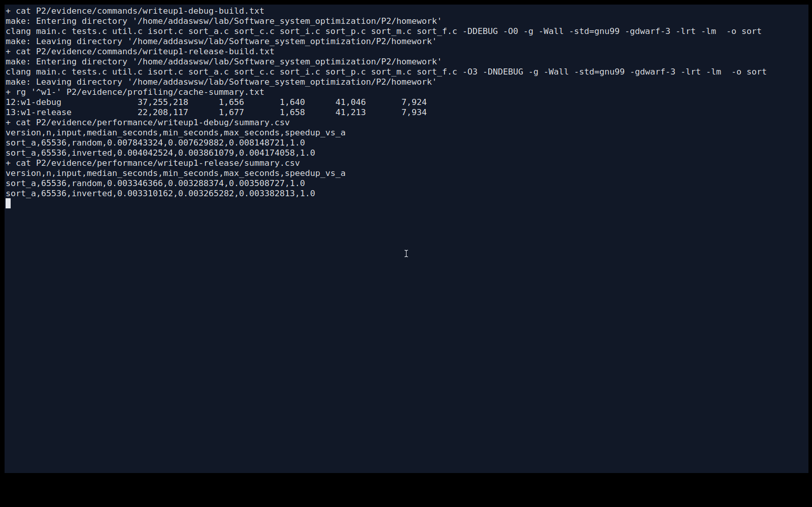

指令数较容易复现，不直接受系统调度、CPU 频率波动影响，适合比较执行工作量。但指令的延迟、并行执行能力、访存等待和分支预测代价不同，相同指令数不代表相同时间。表中指令数还包含驱动和库函数；优化后 D refs 大幅减少，miss 总数基本相同，miss rate 的上升也不能直接解释为缓存行为变差。

后续统一使用 `-O3 -DNDEBUG -g -Wall -std=gnu99 -gdwarf-3`，不使用 LTO 或 `-march=native`。计时仅包围排序入口，包含它必需的分配和释放。固定逻辑 CPU 2、seed 42；N 为 4096、65536、1048576，每组 5 个独立进程，每进程 R=5，先各做一次不计入统计的预热。以下耗时均为**各进程平均排序耗时的中位数**；加速比为 `sort_a 耗时 / 当前版本耗时`。

## Write-up 2

[sort_i.c](homework/sort_i.c) 为 `copy_i`、`merge_i` 添加 `static inline`，并尝试将内部递归函数写成 `static inline`，外部 `sort_i` 仍保持原接口。也检查了 `util.c` 的 `mem_alloc`、`mem_free`；它们保留为各版本共用的外部函数，避免为单个版本的实验改变共享分配行为。

编译器 remarks 和真实汇编都确认 `copy_i` 进入了 `merge_i`，`merge_i` 进入了递归函数，已没有对这两个函数的调用；`mem_alloc`、`mem_free` 的调用仍在。原版 O3 也自动内联了复制和归并，`sort_a` 与 `sort_recursive_i` 的机器码均为 **841 B**，`sort_i` 入口只有 **2 B** 的跳转。

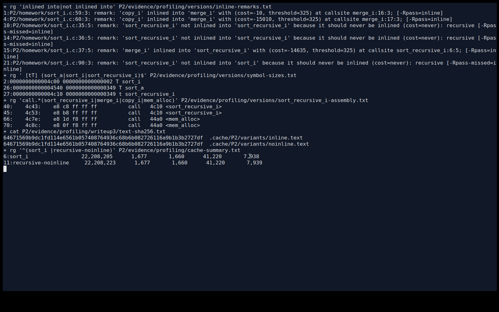

N=1048576 时，random 的原版与内联版为 **62.6914 / 62.8199 ms**，inverted 为 **62.3506 / 62.5056 ms**，没有明显收益。中等规模有小幅变化，但几组比较并未表现出稳定的内联加速；在这里，关键字没有带来原版尚未进行的主要内联。

## Write-up 3

本次编译器没有展开递归内联。两处递归 `call sort_recursive_i` 都保留，Clang 明确报告原因是 `recursive`。另将该函数改为 `noinline` 做对照，两份程序的完整 `.text` SHA-256 相同，递归函数仍为 841 B，没有观察到代码膨胀。

| 递归辅助函数设置 | 全进程 I refs | I1 misses | LLi misses | 大规模 random 正常耗时 |
|---|---:|---:|---:|---:|
| inline 提示 | 22,208,205 | 1,677 | 1,660 | 62.8199 ms |
| noinline 对照 | 22,208,223 | 1,677 | 1,660 | 62.4424 ms |

Cachegrind 固定 N=32768、R=1、seed 42、random；正常时间沿用 N=1048576、R=5 的单独测量。机器码相同，不能把这点时间差解释为递归内联的收益。

如果编译器进行了有限层递归展开，可能减少调用，也可能增大代码、增加寄存器压力或指令缓存缺失。可以对照代码体积、I refs、I1/LLi misses 和正常耗时判断；本次没有发生递归展开，也没有观察到相应缓存恶化。

## Write-up 4

[sort_p.c](homework/sort_p.c) 在内联版基础上，将复制、归并改成指针递增，仍保留两块临时空间、相同哨兵和递归结构。指针写法可能减少下标计算，但编译器也会将数组访问转换为类似的地址运算，不能保证更快。

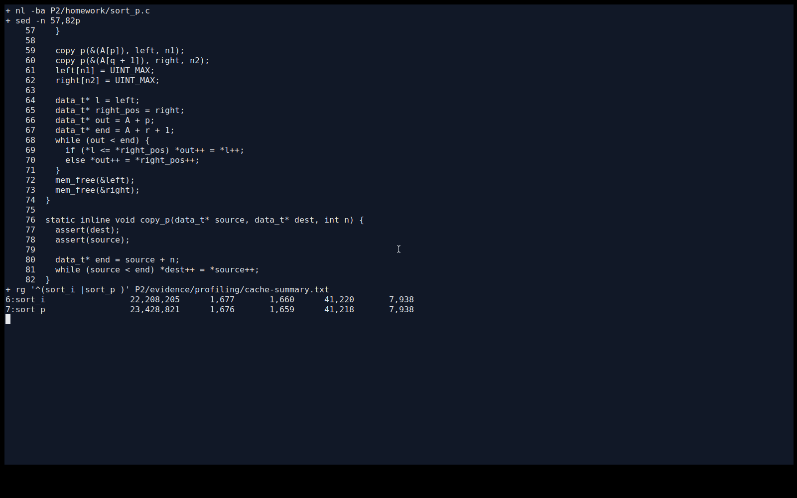

真实汇编中两版都有按 4 字节递增的地址计算和 `cmovb`，指针版递归函数为 **677 B**，小于内联版的 841 B；但 Cachegrind 全进程 I refs 从 **22,208,205** 增至 **23,428,821**，模拟条件分支误预测从 **78,564** 增至 **107,816**。静态代码更短，没有转化成更少的动态工作量。

N=1048576 时，random 为 **67.7730 ms**，inverted 为 **67.6190 ms**，相对 `sort_a` 分别为 **0.925× / 0.922×**。在本次编译器和输入上，指针版出现退化。

## Write-up 5

[sort_c.c](homework/sort_c.c) 对不超过 **32** 个元素的小区间使用插入排序，大区间继续递归归并。插入排序无需临时分配，循环简单，适合小区间。使用的 [isort.c](homework/isort.c) 先检查 `pos > begin` 再访问 `pos[-1]`，不会把指针递减到数组起点之前；区间两端仍为闭区间。

粗化前，对 a/i/p 在中、大规模的两种输入等权比较，i 和 p 的综合加速比分别为 **0.990 / 0.927**，因此从测得最快的 a 复制。阈值只比较预定的 8、16、32、64，没有继续搜索：

| 阈值 | 中等 random / inverted（ms） | 大规模 random / inverted（ms） | 综合耗时比（相对阈值 8） |
|---:|---:|---:|---:|
| 8 | 2.3906 / 2.1645 | 50.1707 / 46.3730 | 1.0000 |
| 16 | 2.4049 / 2.0692 | 49.7977 / 44.2847 | 0.9771 |
| 32 | 2.3146 / 2.0854 | 49.2438 / 43.9373 | 0.9651 |
| 64 | 2.3996 / 2.3722 | 50.1789 / 47.9416 | 1.0327 |

综合耗时比是四组中位数相对阈值 8 的比值的几何平均，越小越好。32 在这些候选中最低，与 16 的差距较小；64 在逆序输入上变慢，不把本次选择当作通用最优阈值。

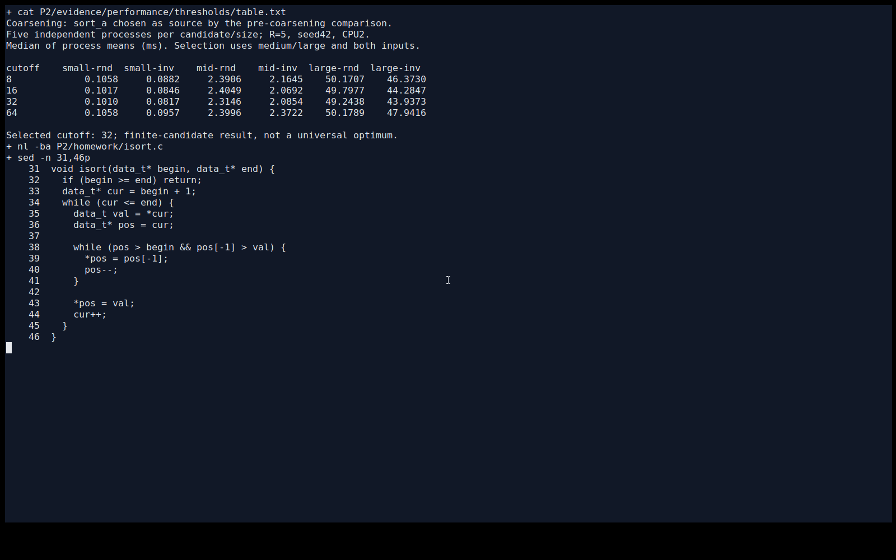

最终六版本对照中，c 的大规模 random / inverted 为 **51.5426 / 44.3056 ms**，相对 a 为 **1.216× / 1.407×**。粗化减少了小区间递归、分配和归并；阈值选择与最终全版本对照是不同批次，表中保留各自结果。

## Write-up 6

[sort_m.c](homework/sort_m.c) 仅复制左半区，右半区留在原数组，从前向后归并。设左侧已读取 i 个元素、右侧读指针为 j、写指针为 k，则 `j-k = n1-i`；左侧未耗尽时 k<j，写入不会覆盖尚未读取的右侧数据。左侧先耗尽时 k=j，右侧余量已经就位；右侧先耗尽时复制左侧余量即可。

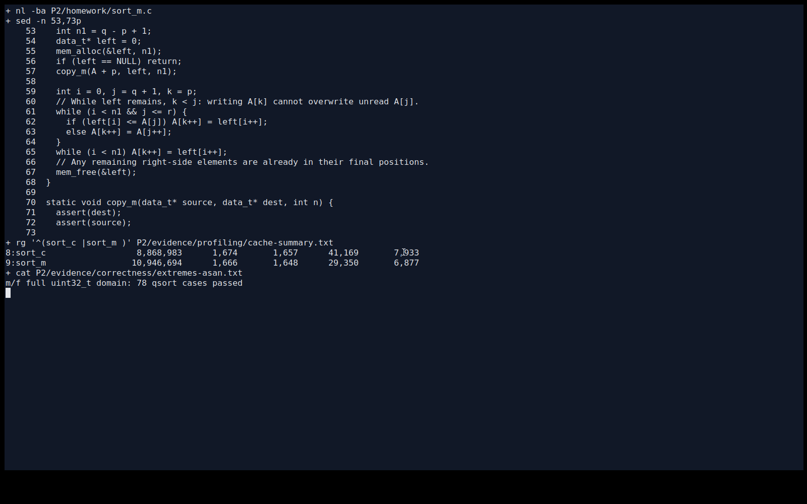

大规模 random 从 c 的 **51.5426 ms** 变成 **55.4710 ms**，有所退化；inverted 从 **44.3056 ms** 降到 **27.1425 ms**。在相同 random Cachegrind 输入下，D1 misses 从 **41,169** 降为 **29,350**，但 I refs 从 **8,868,983** 增为 **10,946,694**。省去右侧复制和分配的同时，归并循环增加了边界控制，缓存 miss 减少并不保证整体更快。

单次归并的临时元素数由 `n+2` 减少为 `ceil(n/2)`，辅助空间仍为 O(n)；不能据此说整个进程内存减少 50%。编译器通常不能自动把两块已分配数组改成这种单缓冲区归并，因为这需要重新安排数据来源、维护读写覆盖关系，并改变分配行为，超出了局部表达式或循环化简。

a/i/p/c 仍继承原版的 `UINT_MAX` 哨兵限制，正常比较使用共同的 `[0, 2^31)` 数据域。m/f 不依赖该哨兵，另用包含 `UINT_MAX`、全相同值和混合极值的输入作了逐元素对照。

## Write-up 7

[sort_f.c](homework/sort_f.c) 在外部入口分配一次 `ceil(n/2)` 大小的缓冲区，传给递归辅助函数复用，返回前释放；每次外部调用独立分配，没有跨调用保存的全局缓冲区。这一次分配和释放也在计时内。

对 N=1048576，使用链接时 `malloc/free` 包装单独计数，m 各调用 **32,767** 次，f 各调用 **1** 次；与阈值 32 下 32,768 个叶区间、32,767 个归并节点的推导一致。

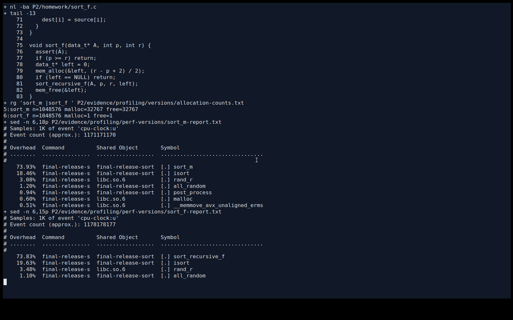

大规模 random 从 m 的 **55.4710 ms** 变为 f 的 **54.8455 ms**，inverted 从 **27.1425 ms** 变为 **26.7741 ms**；中等规模 f 则略慢。单版本 random 的 Perf 中，m 的 `sort_m` Self 为 **73.93%**，`malloc` 为 **0.60%**；f 的递归函数 Self 为 **73.83%**，主要工作仍在归并和插入排序。Cachegrind I refs 从 **10,946,694** 小降到 **10,773,775**，D1 misses 从 **29,350** 降到 **28,624**。

粗化已经大幅减少分配，进一步复用只占较小改进空间。本次测量没有显示 f 相对 m 的稳定明显收益；Perf 百分比包含整个进程，未出现分配器热点也不等于分配成本精确为零。

## 简短总结

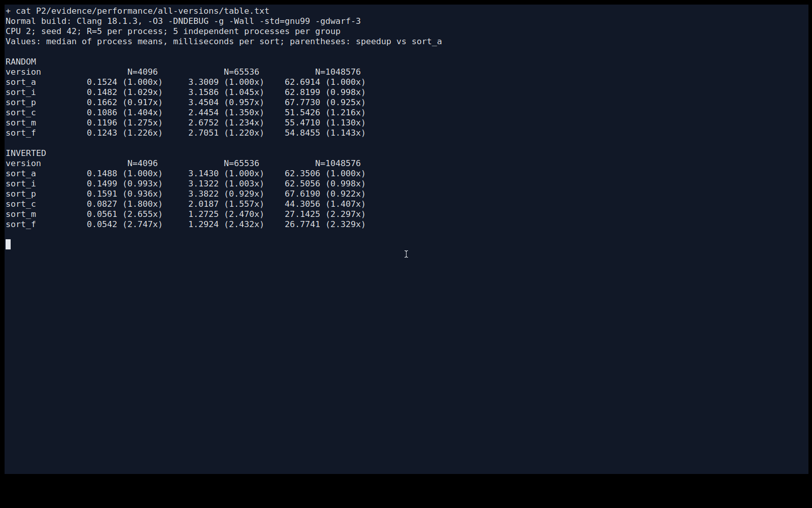

随机输入下 c 最快，逆序输入下 m/f 更快。按中、大规模两种输入等权计算，m/f 的综合加速比分别为 **1.6772× / 1.6765×**，几乎相同；综合使用选择接口实现较直接的 m，若只处理本次随机输入则选择 c。内联和指针改写没有自动带来加速，减少 miss、分配次数或静态代码体积，也都需要结合正常时间判断。

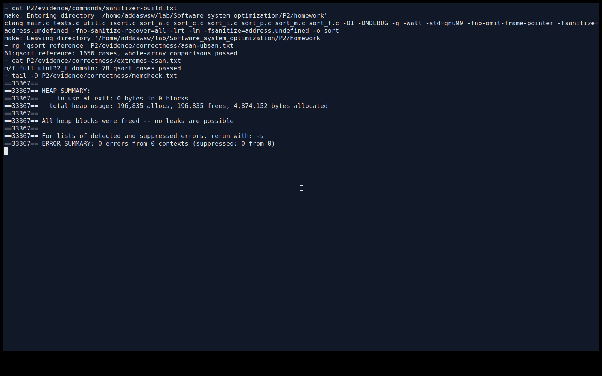

六个版本合计与 `qsort` 作了 1656 个全数组比较，覆盖空区间、单/双元素、奇数长度、已排序、逆序、随机、重复值、阈值及二次幂附近长度、非零起点和区间外数据。ASan/UBSan 与 Memcheck 均未报告错误，m/f 另通过 78 个完整 uint32_t 数据域用例。

源码保持官方 `recitation/`、`homework/` 结构。基本运行方式：

```bash
cd P2/homework
make -B DEBUG=0
./sort -s 42 65536 5
./sort -b -s 42 -v sort_m -t random 1048576 5
```

`-v` 选择版本，`-t` 选择 random/inverted/all，`-b` 只运行计时输入测试；完整正确性检查使用不带 `-b` 的命令。驱动修正了分输入累计计时、种子状态、重复注册和失败返回，并补充了 release 下也生效的逐元素对照。

题目与代码来自 [MIT 6.172 Homework 2](https://ocw.mit.edu/courses/6-172-performance-engineering-of-software-systems-fall-2018/796439e646c02f44348d50b1836ff7f9_MIT6_172F18hw2.pdf) 和[官方 starter](https://ocw.mit.edu/courses/6-172-performance-engineering-of-software-systems-fall-2018/b050ca87021170ea0319bce601ae17d3_MIT6_172F18_hw2.zip)。
