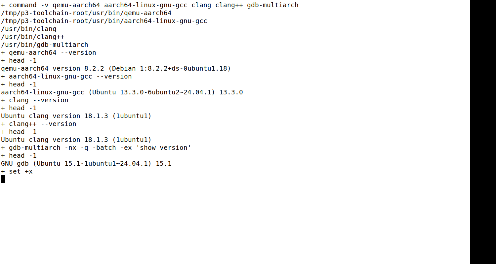
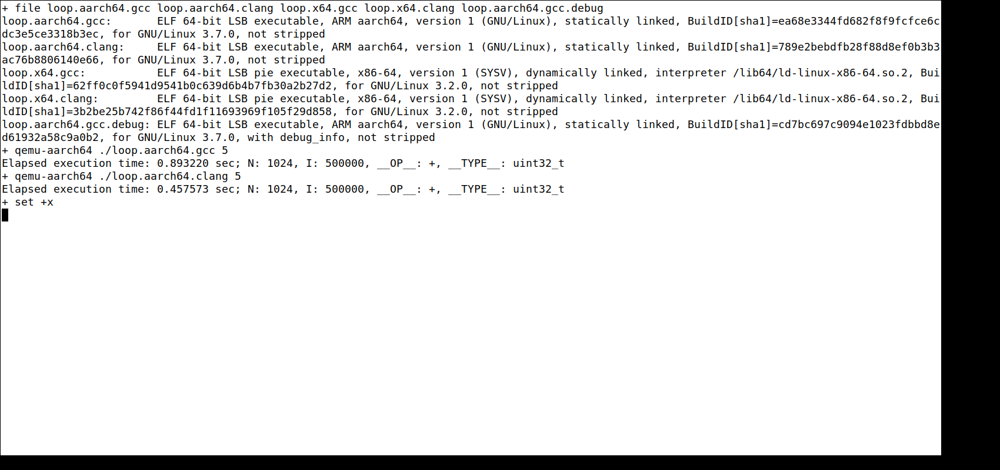
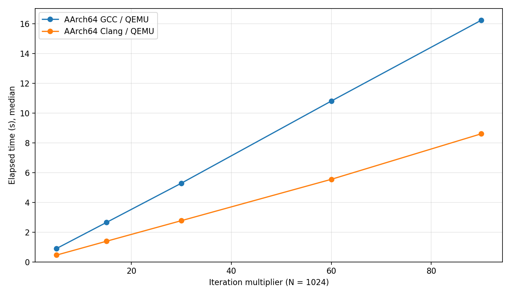
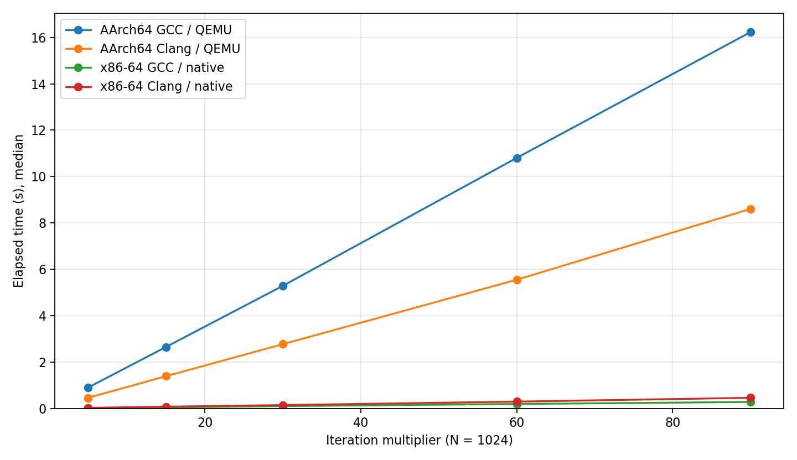
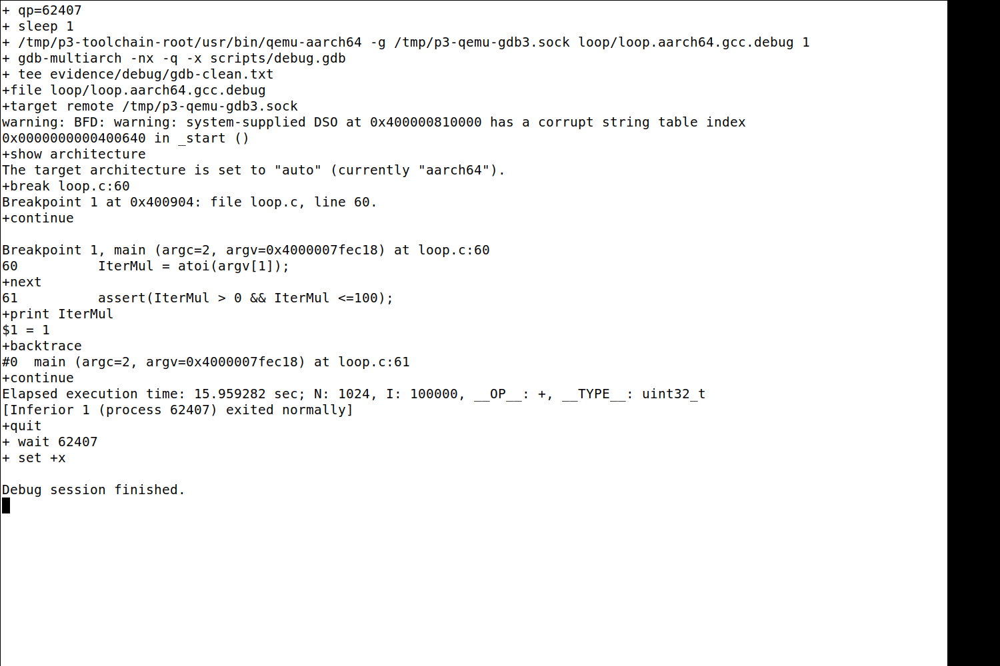

# 实践项目 P3：交叉编译和跨平台应用仿真

学号：10245102410  
姓名：吴博闻

## 实验环境

- 系统：Ubuntu 24.04.2 LTS，WSL2，x86-64，Linux 6.18.33.2-microsoft-standard-WSL2。
- CPU：Intel Core Ultra 9 185H，系统显示 22 个逻辑 CPU。
- 内存：15 GiB。
- 编译交叉程序时，`PATH` 加入 `/tmp/p3-toolchain-root/usr/bin`，`LD_LIBRARY_PATH` 设为 `/tmp/p3-toolchain-root/usr/lib/x86_64-linux-gnu`。Clang 的 `--gcc-toolchain` 指向解包后的 `/tmp/p3-toolchain-root/usr`。AArch64 程序静态链接，运行时没有设置 `QEMU_LD_PREFIX`。

## Write-up 1

系统原来没有 `qemu-aarch64`。本机没有免密码 sudo，因此从 Ubuntu 软件源下载软件包并解包到临时目录，而没有进行系统级安装。实际使用的命令包括：

```bash
mkdir -p /tmp/p3-toolchain-pkgs /tmp/p3-toolchain-root
cd /tmp/p3-toolchain-pkgs
apt-get download qemu-user gcc-aarch64-linux-gnu gcc-13-aarch64-linux-gnu gcc-13-aarch64-linux-gnu-base cpp-13-aarch64-linux-gnu cpp-aarch64-linux-gnu binutils-aarch64-linux-gnu libgcc-13-dev-arm64-cross libc6-dev-arm64-cross libc6-arm64-cross linux-libc-dev-arm64-cross libgcc-s1-arm64-cross libgomp1-arm64-cross libatomic1-arm64-cross libasan8-arm64-cross liblsan0-arm64-cross libtsan2-arm64-cross libubsan1-arm64-cross libhwasan0-arm64-cross
for package in /tmp/p3-toolchain-pkgs/*.deb; do dpkg-deb -x "$package" /tmp/p3-toolchain-root; done
```

`qemu-aarch64` 版本为 8.2.2，位置为 `/tmp/p3-toolchain-root/usr/bin/qemu-aarch64`；版本查询及程序运行见下图和 Write-up 3。`qemu-aarch64` 在宿主 Linux 上仿真单个 AArch64 用户态程序并转换系统调用；`qemu-system-aarch64` 仿真整台机器及设备，可启动目标系统内核。



## Write-up 2

AArch64 GCC 工具链与目标库通过上面的下载和解包命令取得；Clang、Clang++ 原已安装。AArch64 GCC 为 13.3.0，Clang 和 Clang++ 均为 18.1.3，QEMU 为 8.2.2。交叉 GCC 位于 `/tmp/p3-toolchain-root/usr/bin/aarch64-linux-gnu-gcc`，Clang 位于 `/usr/bin/clang`，Clang++ 位于 `/usr/bin/clang++`。版本和位置的命令输出见上图。

## Write-up 3

以下命令从 `loop/` 执行。编译器和链接器从解包目录取得：

```bash
export PATH=/tmp/p3-toolchain-root/usr/bin:$PATH
export LD_LIBRARY_PATH=/tmp/p3-toolchain-root/usr/lib/x86_64-linux-gnu
aarch64-linux-gnu-gcc -O2 -static loop.c -o loop.aarch64.gcc
qemu-aarch64 ./loop.aarch64.gcc 5
```

程序输出执行时间、`N: 1024`、`I: 500000`、加法和 `uint32_t`。两种交叉程序的运行结果如下：



## Write-up 4

```bash
clang --target=aarch64-linux-gnu --gcc-toolchain=/tmp/p3-toolchain-root/usr -O2 -static loop.c -o loop.aarch64.clang
qemu-aarch64 ./loop.aarch64.clang 5
file loop.aarch64.gcc loop.aarch64.clang
```

`file` 显示两个文件均为静态链接的 AArch64 ELF。x86-64 CPU 不直接执行 AArch64 指令，QEMU 将目标指令转换后在宿主机运行。若系统的 `binfmt_misc` 自动调用 QEMU，直接输入程序名能够运行也不代表 CPU 原生执行了 AArch64 指令。

## Write-up 5

测试命令如下，将参数依次替换为 5、15、30、60、90，每种条件运行三次；每次均为独立进程：

```bash
qemu-aarch64 ./loop.aarch64.gcc 5
qemu-aarch64 ./loop.aarch64.clang 5
```

下表为三次输出的中位数，括号内为最小值至最大值，单位为秒。程序使用 `CLOCK_MONOTONIC` 测量核心区域经过时间，参数是迭代倍数，数组长度 `N` 固定为 1024。全部三次数据和原始输出分别见 [汇总表](results/summary.csv) 和 [运行记录](results/formal/runs.csv)。

| 倍数 | AArch64 GCC / QEMU | AArch64 Clang / QEMU |
|---:|---:|---:|
| 5 | 0.899144 (0.868214–0.905354) | 0.458771 (0.456193–0.493848) |
| 15 | 2.651933 (2.612288–2.701139) | 1.389316 (1.348117–1.389647) |
| 30 | 5.289055 (5.213825–5.296324) | 2.772405 (2.771928–2.821817) |
| 60 | 10.804603 (10.559979–11.130791) | 5.548397 (5.542665–5.638647) |
| 90 | 16.229141 (16.084102–16.529703) | 8.603627 (8.389780–8.828672) |



本次五个参数下，Clang 生成的 AArch64 程序在 QEMU 中均快于 GCC 版本。该结果只适用于这份源码、编译选项和当前环境。

## Write-up 6

```bash
gcc -O2 loop.c -o loop.x64.gcc
clang -O2 loop.c -o loop.x64.clang
./loop.x64.gcc 5
./loop.x64.clang 5
```

其余参数同样为 15、30、60、90，各运行三次：

| 倍数 | x86-64 GCC / Native | x86-64 Clang / Native |
|---:|---:|---:|
| 5 | 0.015342 (0.014582–0.015829) | 0.026960 (0.024597–0.030375) |
| 15 | 0.046467 (0.044938–0.050486) | 0.075254 (0.072722–0.077372) |
| 30 | 0.100710 (0.099279–0.113606) | 0.145192 (0.136858–0.155054) |
| 60 | 0.192072 (0.188244–0.196697) | 0.293973 (0.292309–0.313349) |
| 90 | 0.279378 (0.278537–0.281579) | 0.459208 (0.444502–0.463400) |



这四条路径同时涉及目标指令集、编译器生成的代码和是否经 QEMU 仿真，不能把时间差全部归因于 QEMU，也不是实际 ARM 硬件与 x86 硬件的比较。四个版本的核心代码都保留了循环，但优化结果不同：AArch64 两个版本和 x86-64 Clang 保留向量加法；x86-64 GCC 将零数组的加法简化为反复向量写零。源码末尾的随机读取本身不保证所有运算都不会被优化。

[采集脚本](scripts/measure.py) 接受输出目录、逗号分隔的参数和重复次数；输出目录必须尚不存在。设置 `QEMU` 后，可从 P3 目录运行 `python3 scripts/measure.py 新目录 5,15,30,60,90 3`。`python3 scripts/analyze.py 新目录/runs.csv 输出目录` 使用新数据生成汇总和图表。

## Write-up 7

`gdb-multiarch` 原已安装，无需再次安装。`command -v gdb-multiarch` 显示 `/usr/bin/gdb-multiarch`，版本为 GNU GDB 15.1。`gdb-multiarch -nx -q -batch -ex 'show version'` 正常启动并显示版本，见工具版本截图。

## Write-up 8

调试版本在 `loop/` 下编译：

```bash
aarch64-linux-gnu-gcc -O0 -g -static loop.c -o loop.aarch64.gcc.debug
```

`-g` 保留源码调试信息，`-O0` 降低优化对源码单步的影响。它与前面的 `-O2` 程序分开。

在 P3 目录启动 QEMU，然后使用另一终端连接本机 Unix socket：

```bash
qemu-aarch64 -g /tmp/p3-qemu-gdb3.sock loop/loop.aarch64.gcc.debug 1
gdb-multiarch -nx -q loop/loop.aarch64.gcc.debug
```

在 GDB 中依次执行 `target remote /tmp/p3-qemu-gdb3.sock`、`break loop.c:60`、`continue`、`next`、`print IterMul`、`backtrace` 和 `continue`。断点停在参数赋值语句，单步执行赋值后 `IterMul` 为 1，表示使用基础次数 100000 的一倍；调用栈显示位于 `main`。再次继续后程序正常结束。GDB 提示系统提供的 DSO 字符串表警告，但程序源码定位、断点和执行均可用。[调试命令文件](scripts/debug.gdb) 可复现同一会话。


